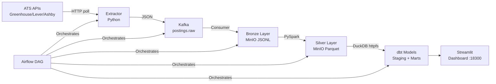

# Job Market Data Platform

A batch + stream data pipeline that tracks public job postings from Greenhouse, Lever, and Ashby ATS boards. Built to learn the data engineering stack properly: Kafka, Spark, dbt, Airflow, Streamlit — on real but small-scale data (thousands of postings/day, not petabytes).

This is a portfolio project. It runs on a laptop with Docker, not in production.

## Architecture



## Quickstart

```bash
# 1. Clone and set up
cp .env.example .env
pip install -r requirements.txt

# 2. Start Kafka + MinIO
make up

# 3. Run the full pipeline (live APIs)
make e2e

# 4. Build dbt models on seed data
make dbt-build

# 5. View dashboard
make dashboard
# Open http://localhost:18300

# 6. Data quality report
make report
```

**Real output from E2E run on this laptop (see VERIFY.md for full output):**

```
Companies loaded: 37 (17 greenhouse, 7 lever, 13 ashby)
Extracted: 5937 postings in 122.7s
  Greenhouse: 4352 | Lever: 183 | Ashby: 1402
Bronze rows: 5937 | Silver rows: 5937 | Dedupe ratio: 0.0%

Top 10 skills:
  (skill counts below are from before the Go-pattern fix, which over-counted Go by matching the English verb; re-run `make e2e` for corrected counts)
  Data Pipelines                  1720 postings
  Go                              1655 postings
  Machine Learning                1128 postings
  Python                          1087 postings
  Databricks                       945 postings
```

## Results

| Stage         | Rows   | Notes                              |
|---------------|--------|------------------------------------
| Bronze (raw)  | 5937   | One snapshot, laptop, python only |
| Silver        | 5937   | After dedupe (0% on single day)   |
| dbt mart      | ~5k    | Fixture seed: 10 rows; live: ~5k  |

*Numbers from VERIFY.md. Single-day snapshot — first_seen = last_seen for all records. Run twice on different calendar days to see SCD-style tracking.*

## Design Decisions

See [docs/DESIGN.md](docs/DESIGN.md) for full reasoning. Short version:

- **Kafka instead of direct write**: keeps extract and land decoupled; lets replay on schema changes
- **MinIO not HDFS**: S3-compatible object store, simpler ops, same API as AWS S3
- **DuckDB not Postgres for dbt**: reads Parquet directly via httpfs; no warehouse needed for this scale
- **Deterministic skill taxonomy**: regex over ML — reproducible, testable, no inference cost
- **One daily DAG**: batch is fine at this scale; stream processing (Flink) would be over-engineering

## Limitations / What's Next

- Single snapshot only: time-to-close and SCD tracking requires multiple daily runs
- No auth-required ATS boards (Naukri, LinkedIn) — only public APIs
- Spark runs in local mode (no cluster); for production add YARN or Databricks
- Airflow runs in standalone/LocalExecutor mode — not production-grade HA
- Skill taxonomy is regex-based: false positives exist (e.g. `\bgo\b` matches non-Go contexts)
- Dashboard has no auth; fine for local/portfolio use

## MIT License

Copyright (c) 2024 Yashash Mathur. See [LICENSE](LICENSE).
